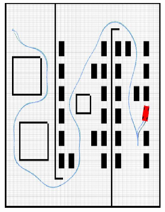
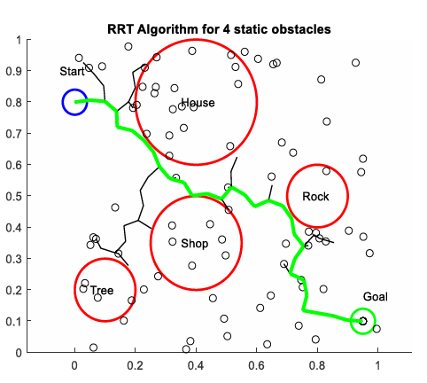
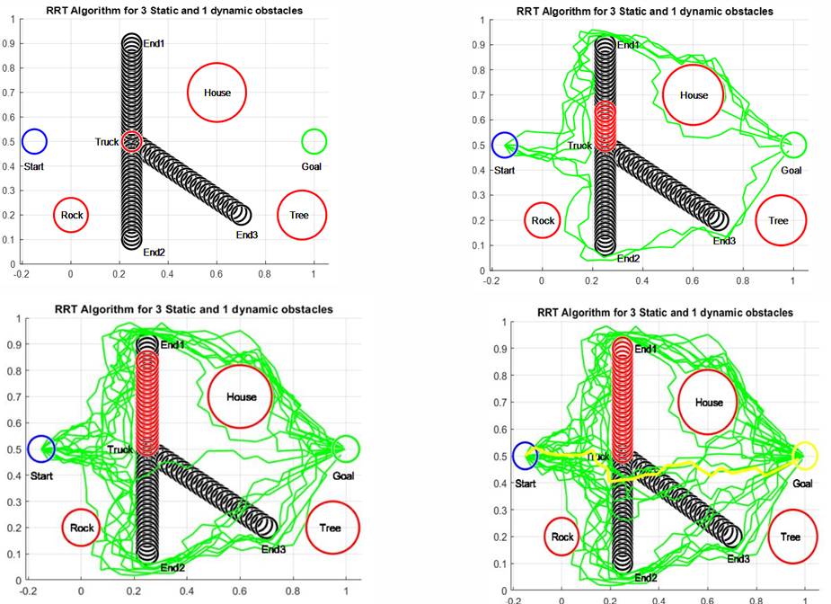
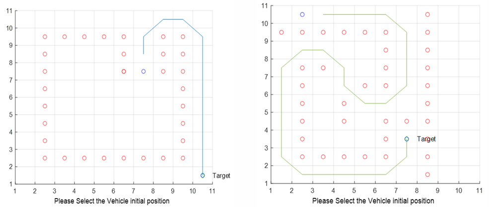

# Path Planning Algorithms for an Autonomous Vehicle

MATLAB simulations exploring RRT and A* path planning,
static and dynamic obstacles, and probabilistic route selection.

## Project Overview

This project investigates how an autonomous vehicle can select
routes through simulated environments containing obstacles.

The work includes Rapidly Exploring Random Tree (RRT) planning,
moving-obstacle scenarios, route-confidence updates, and
A* search in grid-based maze environments.

The implementations are simulations rather than a deployed
physical-vehicle navigation system.

## My Contributions

- Developed MATLAB simulations for RRT-based path planning.
- Created environments containing static and moving obstacles.
- Generated and visualized candidate vehicle routes.
- Implemented probabilistic updates to route confidence
  based on obstacle proximity.
- Investigated route selection as a simulated truck moved
  through the environment.
- Used and adapted an existing A* demonstration for grid-based
  maze planning and visualization.
- Documented the algorithms, simulation sequence, and results.

## RRT Path Planning

RRT explores the environment by sampling points and extending
a search tree toward those samples.

The simulations visualize tree growth, obstacles, and selected
routes to investigate planning behavior in different scenarios.

## Dynamic Obstacles and Possible Truck Routes

The truck-route simulation considers three candidate routes.

As the simulated truck moves, the program evaluates its proximity
to candidate routes, updates route-confidence values, and modifies
the planning environment using route-associated obstacle regions.

The report and detailed description explain the scenario sequence,
including the initial conditions, intermediate truck positions,
and resulting route-selection behavior.

The confidence calculation uses a fixed prior for each update;
it should not be interpreted as a fully recursive Bayesian tracker.

## A* Maze Planning

The A* component uses heuristic-guided search to find a route
between start and goal locations in grid-based maze environments.

This part uses and adapts an existing MathWorks demonstration.
Original attribution is retained in the supporting materials
and source files.

## Technologies and Methods

MATLAB • Rapidly Exploring Random Trees (RRT) • A* Search •
Occupancy Grids • Static and Dynamic Obstacles •
Probabilistic Route Confidence • Simulation and Visualization

## Simulation Screenshots

### RRT Path Planning

Simulation showing the exploration tree, obstacles, and a selected route.

### Truck-Route Scenario

Example simulation state showing the truck and candidate routes
during the route-confidence evaluation.

### A* Maze Planning

Grid-based planning example showing the start, goal, obstacles,
and computed route.

## Project Documentation

- [View Project Portfolio](./Dak-Amarasinghe-Path-Planning-Portfolio.pdf)
- [View Detailed Project Description](./Autonomous-Vehicle-Path-Planning-Project-Description.pdf)

The documents include algorithm explanations, simulation screenshots,
the truck-route scenario sequence, implementation details,
and development limitations.

## Engineering Skills Demonstrated

Algorithm Implementation • Path Planning • MATLAB Programming •
Simulation Design • Probabilistic Reasoning •
Obstacle Representation • Technical Analysis • Visualization

## Current Scope and Future Development

The project demonstrates planning concepts in MATLAB simulations.

Future improvements include complete collision checking along
tree edges, explicit goal-reach verification, repeated-run
performance comparisons, and integration with a physical
robot-navigation system.

## Author

**Dakshitha (Dak) Amarasinghe**

[GitHub Portfolio](https://github.com/DakAmarasinghe1994) |
[LinkedIn](https://www.linkedin.com/in/dak-amarasinghe-946aa71b1/)

## Source Code

The MATLAB scripts and supporting files are available in the
[src folder](./src).

Preserve the folder structure when downloading the code, and
retain the original attribution included with the A* demonstration.

## Setup and Execution

See the [setup and execution instructions](./instructions/Instruction.txt)
for running the MATLAB simulations.
